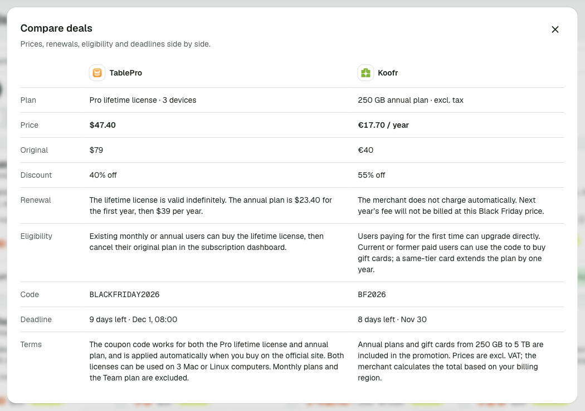

<div align="center">


# Deal Index · 好价清单

Browse Black Friday, Cyber Monday, and year-round software deals. See what you pay up front, what renewal costs, and whether existing customers qualify.

[Browse deals](https://deals.laifuyou.com/en) · [RSS feed](https://deals.laifuyou.com/en/feed.xml) · [中文 README](README.md)

[](https://github.com/JS-banana/deals/actions/workflows/ci.yml)
[](LICENSE)

</div>



_Deal comparison on November 22, 2026 · [View full size](docs/images/compare-en.png)_

## Choosing a deal

- **Filter by how you buy.** Browse by category or sale status, or narrow the list to one-time purchases and offers open to existing customers. Select two or three deals to compare their terms side by side.
- **Check the quote.** Prices keep the merchant’s currency and billing period. If the merchant publishes only a discount, that’s what the listing shows. Open a deal to see the source, the date it was checked, and any available price history.
- **Save it for later.** Bookmark a deal and return to it under “Saved deals.” Your list stays in the current browser without an account.

## Where the deals come from

“Merchant verified” means the offer was visible on the merchant’s public page on the date shown. “Community-sourced” means the offer was reported in a community list and still needs confirmation on the merchant’s site.

The worker checks a community list daily and revisits merchant pages for published deals. It uses AI to draft listings in Chinese, checks prices and quotes against the source text, and translates the copy into English. New listings and changes become proposals. By default, a maintainer reviews them in `/admin` before publication. [Upstream community list](https://github.com/trungdq88/Awesome-Black-Friday-Cyber-Monday) · [Collection and translation guide (in Chinese)](docs/pipeline.md)

To report a price change, flag a broken link, or suggest a deal, include the merchant’s URL and the terms to check. [Open an issue](https://github.com/JS-banana/deals/issues)

## Run locally

Use Node.js 22.18 or later, pnpm 12.21.0, and Docker with Compose. From the root of a fresh clone, run the following commands to browse the included Black Friday and Cyber Monday deals.

```sh
pnpm install --frozen-lockfile
cp -n .env.example .env
LLM_API_KEY=unused pnpm db:up --wait
pnpm db:migrate
pnpm db:seed
SITE_URL=http://localhost:3000 pnpm dev
```

Open the [local English site](http://localhost:3000/en) to see the listings. To sign in to the [review console](http://localhost:3000/admin), use `ADMIN_USER` and `ADMIN_PASSWORD` from the root `.env`.

The local preview runs PostgreSQL and the web app. Compose checks for a worker API key when it reads the configuration, so the database startup command supplies `unused` for that invocation. Set valid `LLM_*` values in `.env` before running collection or translation jobs.

## Self-hosting and development

Set the public `SITE_URL`, database password (`POSTGRES_PASSWORD`), admin credentials, and worker model settings in your production `.env`, then start the services with Docker Compose.

```sh
docker compose up -d --build
```

Compose runs database migrations before starting the web app and scheduled worker. The web app listens on `127.0.0.1:3100` by default for use behind a reverse proxy. To load the bundled catalog on first deployment, run `docker compose run --rm migrate node packages/db/src/seed.ts`.

- [Environment settings](.env.example) · [Compose configuration](compose.yaml) · [Nginx, deployment, and backup scripts](deploy/)
- [Web app and review console](apps/web/) · [Worker](apps/worker/) · [Domain model](packages/core/) · [Database and migrations](packages/db/)
- [Contribution guide and pre-commit checks (in Chinese)](CONTRIBUTING.md)
