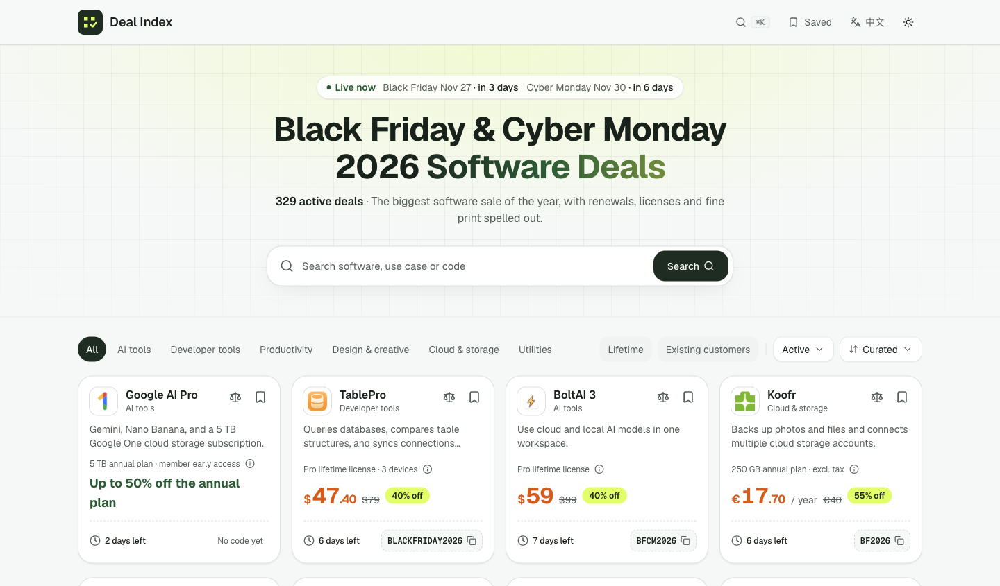

<div align="center">


# Deal Index · 好价清单

Browse Black Friday, Cyber Monday, and year-round software deals. See what you pay up front, what renewal costs, and whether existing customers qualify.

[Browse deals](https://deals.laifuyou.com) · [RSS feed](https://deals.laifuyou.com/feed.xml) · [中文 README](README.zh.md)

[](https://github.com/JS-banana/deals/actions/workflows/ci.yml)
[](LICENSE)

</div>



## Features

- **Fast search and focused filters**: Jump straight to any app via the hero search bar or `⌘K`, and narrow listings by category, sale status, lifetime option, or existing-customer eligibility.
- **Clear quotes and side-by-side comparison**: Prices stay in the merchant’s original currency and billing period, with one-click coupon copying. Select 2–3 deals to compare renewals and terms side by side, and inspect price history where tracked.
- **Account-free bookmarks and community feedback**: Saved deals stay locally in your browser with no sign-in required. Visitors can vote on whether an offer still works or submit new deal tips from the footer.
- **Bilingual and feed-ready**: Ships in English and Chinese, with light/dark themes and RSS feeds.

## Run locally

Use Node.js 22.18 or later, pnpm 12.21.0, and Docker with Compose. From the root of a fresh clone, run these commands to preview the catalog with the bundled sample data:

```sh
pnpm install --frozen-lockfile
cp -n .env.example .env
LLM_API_KEY=unused pnpm db:up --wait
pnpm db:migrate
pnpm db:seed
SITE_URL=http://localhost:3000 pnpm dev
```

Open [http://localhost:3000](http://localhost:3000) (or [http://localhost:3000/zh](http://localhost:3000/zh) for Chinese) to browse the catalog.

## Project layout

| Package                         | Responsibility                                                                        |
| :------------------------------ | :------------------------------------------------------------------------------------ |
| [apps/web](apps/web/)           | Next.js catalog, bilingual zh/en routes, and RSS feeds                                |
| [apps/worker](apps/worker/)     | Automated deal collection, AI extraction and verification, translation, and logo sync |
| [packages/core](packages/core/) | Domain schemas, Zod validation, status/timezone logic, and money formatting           |
| [packages/db](packages/db/)     | Drizzle ORM schema, SQL migrations, and data queries                                  |

## Feedback and contributing

Found an expired offer, wrong price, or bug? [Open an issue on GitHub](https://github.com/JS-banana/deals/issues), or check the [Contribution guide (in Chinese)](CONTRIBUTING.md) before submitting a pull request.
