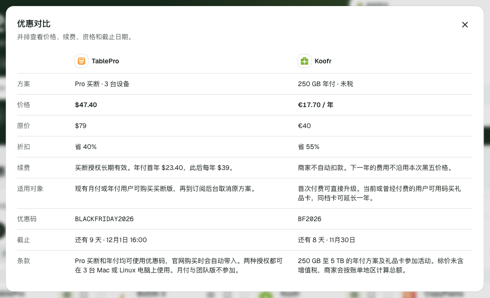

<div align="center">


# 好价清单 · Deal Index

从黑五、网一到常年优惠，查清软件首期付多少、续费怎么算、老用户能不能用。

[浏览优惠](https://deals.laifuyou.com) · [订阅 RSS](https://deals.laifuyou.com/feed.xml) · [English README](README.en.md)

[](https://github.com/JS-banana/deals/actions/workflows/ci.yml)
[](LICENSE)

</div>



_2026 年 11 月 22 日的优惠对比 · [查看大图](docs/images/compare-zh.png)_

## 怎么挑优惠

- **按购买条件筛选。** 可以按软件分类和活动状态浏览，也可以直接筛选「可买断」或「老用户可用」。选两到三款加入对比，就能像上图一样逐项查看条款。
- **核对报价。** 价格按商家原币种和计费周期展示。商家只公布折扣时，页面就显示折扣。详情页附核对日期和来源链接，有价格记录时也能查看历史变化。
- **留到以后再看。** 点优惠卡片上的书签，之后从「我的收藏」找回来。收藏只保存在当前浏览器，无需账号。

## 优惠从哪里来

「商家已核实」表示核对当天能在商家公开页面确认该活动。「社区收录」表示线索来自社区清单，仍待商家页面佐证。

Worker 每天从社区清单发现新优惠，并定期复查已收录的商家页面。AI 提取条款、生成中文文案并翻译成英文，程序对照原文核验报价和引文。新增和变更会生成提案，默认由维护者在 `/admin` 审核后发布。[上游社区清单](https://github.com/trungdq88/Awesome-Black-Friday-Cyber-Monday) · [采集与翻译流程](docs/pipeline.md)

发现价格有变、链接失效，或想推荐优惠，可以在 Issue 里附上商家页面和需要核对的条款。[反馈与推荐](https://github.com/JS-banana/deals/issues)

## 本地运行

需要 Node.js 22.18 或更高版本、pnpm 12.21.0，以及带 Compose 的 Docker。在新克隆的仓库根目录运行以下命令，即可用仓库自带的黑五网一数据浏览目录。

```sh
pnpm install --frozen-lockfile
cp -n .env.example .env
LLM_API_KEY=unused pnpm db:up --wait
pnpm db:migrate
pnpm db:seed
SITE_URL=http://localhost:3000 pnpm dev
```

打开 [本地首页](http://localhost:3000) 即可看到优惠。进入 [审核后台](http://localhost:3000/admin) 时，使用根目录 `.env` 中的 `ADMIN_USER` 和 `ADMIN_PASSWORD` 登录。

本地预览只启动 PostgreSQL 和 Web。Compose 解析配置时会检查 Worker 的密钥，所以上面的 `unused` 仅供启动数据库时使用。运行采集或翻译任务前，再在 `.env` 中填写有效的 `LLM_*` 配置。

## 自托管与开发

在生产环境的 `.env` 中设置站点地址 `SITE_URL`、数据库密码 `POSTGRES_PASSWORD`、后台凭据和 Worker 的模型配置，然后用 Docker Compose 启动服务。

```sh
docker compose up -d --build
```

Compose 会先执行数据库迁移，再启动 Web 和定时 Worker。Web 默认监听 `127.0.0.1:3100`，供反向代理转发。首次部署若要导入内置清单，运行 `docker compose run --rm migrate node packages/db/src/seed.ts`。

- [环境变量示例](.env.example) · [Compose 配置](compose.yaml) · [Nginx、自动部署与备份脚本](deploy/)
- [Web 前台与审核后台](apps/web/) · [采集 Worker](apps/worker/) · [领域模型](packages/core/) · [数据库与迁移](packages/db/)
- [贡献指南与提交前检查](CONTRIBUTING.md)
